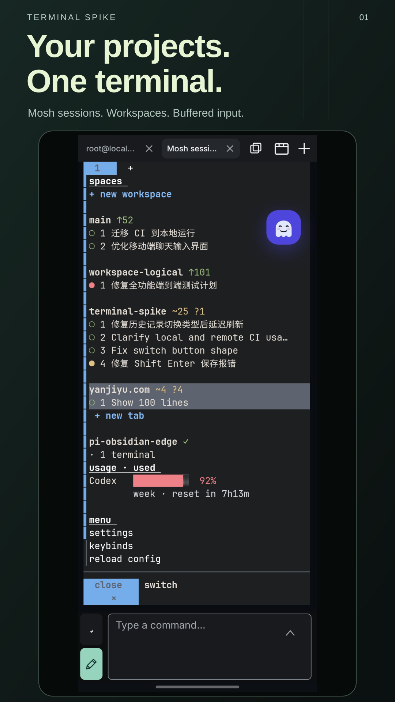
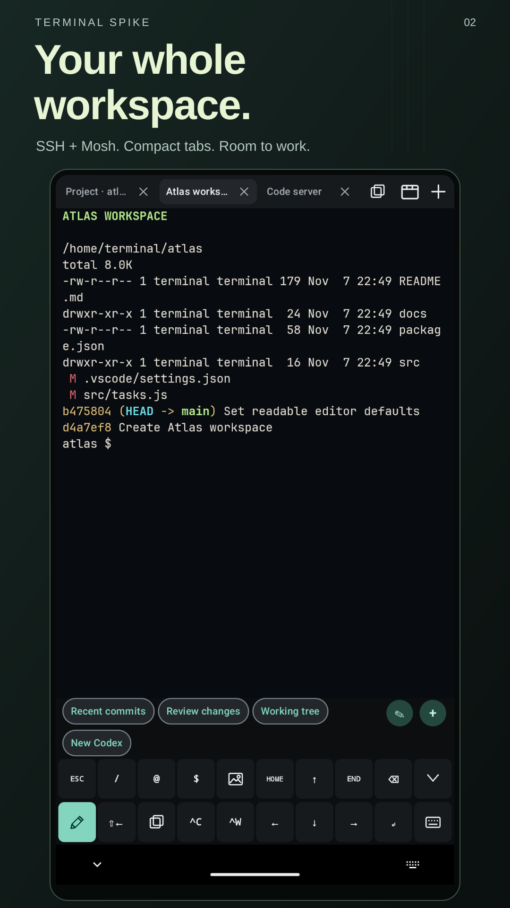
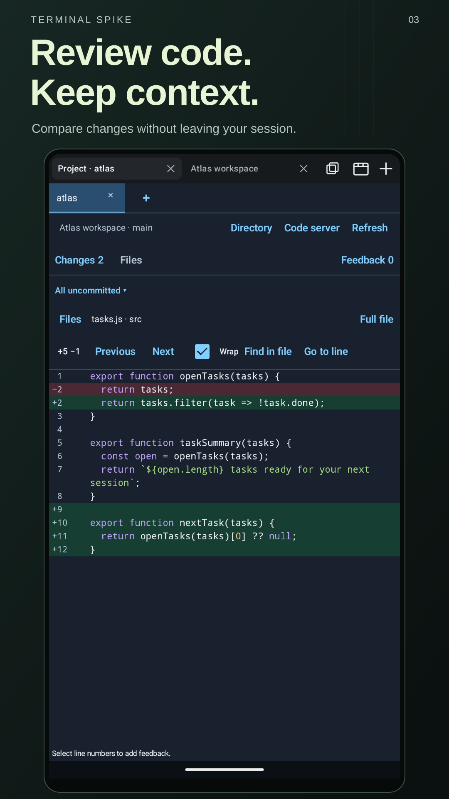
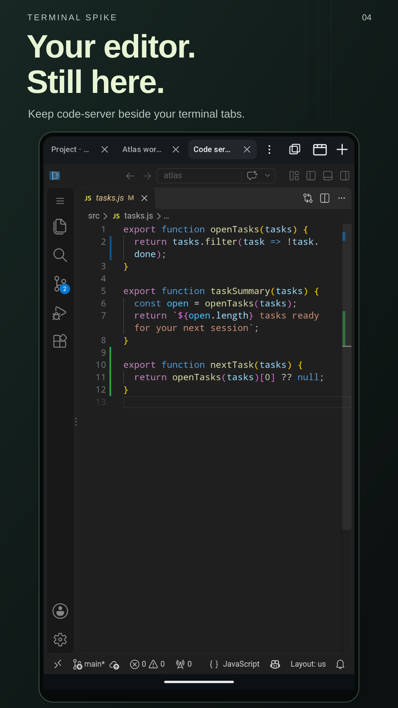

# Terminal Spike

**Your terminal. In your pocket.**

An open-source Android terminal with SSH, built-in Mosh and tabs for your remote sessions.
No ads, analytics or subscriptions. Android 8.0+.

**[Get it on Google Play](https://play.google.com/store/apps/details?id=com.yanjiyu.terminalspike)** · **[Download APK](https://github.com/Anderbone/terminal-spike/releases/download/v0.0.4/terminal-spike-0.0.4.apk)** · [Releases](https://github.com/Anderbone/terminal-spike/releases) · [Website](https://yanjiyu.com/terminal-spike/)

  
  
  
  

- **Connect your way:** SSH passwords or keys, plus Mosh in the same app.
- **Keep working:** multiple tabs, tmux session selection and native scrollback.
- **Made for touch:** custom shortcut keys, themes, fonts and SFTP file transfers.
- **Bring your tools:** use remote CLI tools such as Codex on your own server.
- **Herdr support:** built-in handling for Herdr sessions and pane layout metadata.

## Install and connect

Install from [Google Play](https://play.google.com/store/apps/details?id=com.yanjiyu.terminalspike), or download the APK above, open it on your phone, and allow installation from your browser when Android asks.
Open Terminal Spike → add a connection → enter your server, username and password or key → connect.
Check the host fingerprint against your server before trusting it. Mosh also needs `mosh-server` on your server.

APK and Google Play signing keys differ. Stick with one installation channel for updates;
switching may require exporting a backup and reinstalling.

## Setup & reference

In the app, open **Settings → User guide → Setup & reference** for short setup
steps, a copyable Tailscale Serve command, and links to the official instructions.

- **Tailscale:** install it on your phone and computer, join the same tailnet and
  connect both. For a terminal, your computer also needs an SSH server.
- **Code server:** [install and run code-server](https://coder.com/docs/code-server/install)
  on the computer holding your projects. Keep password authentication enabled.
  [Tailscale Serve](https://tailscale.com/docs/reference/tailscale-cli/serve) can give
  it a private HTTPS address. Paste that address into **Code server** in the app
  and sign in. The app can remember the password encrypted on your phone.
- **Browser:** a separate tab with an address bar for ordinary websites.

Keep your computer awake and the services running. Tailscale and code-server are
configured separately from Terminal Spike; install them only if you need them.
See the [browser reference](docs/EMBEDDED-BROWSER.md) for tab controls and limits.

## Using Herdr on a phone or foldable

See [recommended Herdr settings](docs/HERDR-SETUP.md) for a compact layout,
keeping mobile navigation when a foldable opens, Git indicators, and which features
require our development Herdr build. These settings belong on the computer running
Herdr, rather than in the Android app.

The guide includes [copy-and-send agent instructions](docs/HERDR-SETUP.md#ask-an-agent-to-configure-it)
in English and Chinese for configuring an existing installation without replacing
unrelated settings or interrupting running tasks.

## Google Play

Terminal Spike is now available on [Google Play](https://play.google.com/store/apps/details?id=com.yanjiyu.terminalspike). Install it directly from the store; joining a tester group is no longer required.

Found a bug? [Open an issue](https://github.com/Anderbone/terminal-spike/issues) with your Android version and steps to reproduce it.

[Build & contribute](docs/DEVELOPING.md) · [Security](SECURITY.md) · [Licence](LICENSING.md)

GPL-3.0-or-later; component licences and credits are in [Third-party notices](THIRD_PARTY_NOTICES.md).
Terminal Spike is not affiliated with the Mosh project.

## Support development

Enjoying Terminal Spike? [☕ Buy me a coffee](https://buymeacoffee.com/jiyuyan) to support its development.
