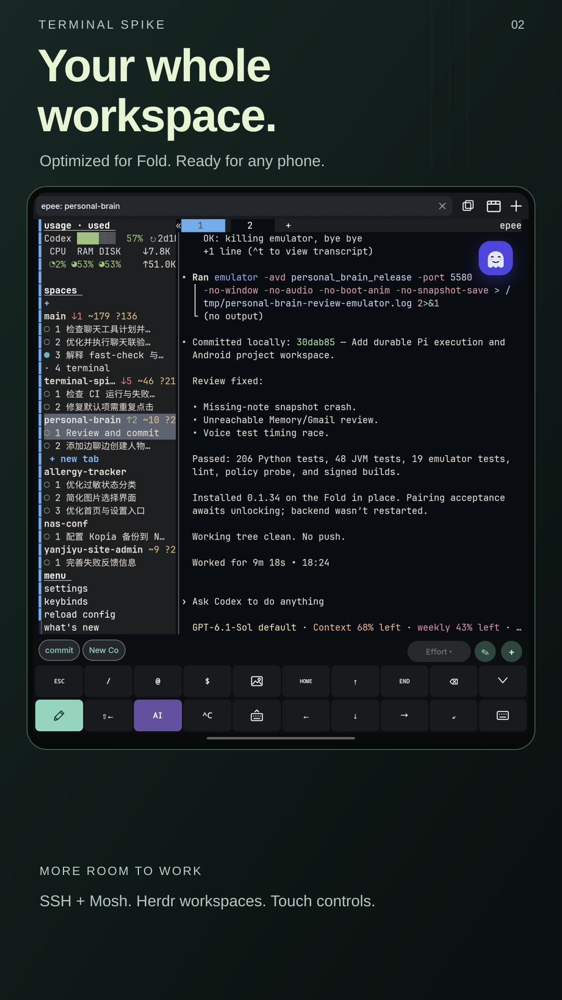

# Terminal Spike

**Your terminal. In your pocket.**

SSH and Mosh on Android. Optimized for Fold, with full support for regular phones.
Open source. No ads or subscriptions. Android 8.0+.

**[Google Play](https://play.google.com/store/apps/details?id=com.yanjiyu.terminalspike)** · **[Download APK](https://github.com/Anderbone/terminal-spike/releases/latest/download/terminal-spike-latest.apk)** · [Release notes](https://github.com/Anderbone/terminal-spike/releases/latest)

  
  
  
  

- SSH and built-in Mosh, with tabs and scrollback.
- Run Codex and other command-line tools on your server.
- Herdr workspaces with touch navigation.
- Custom shortcut keys, snippets, themes and fonts.
- SFTP file transfers, Git diffs and code-server.

## Get started

1. Install the app, then add your server address, username and password or SSH key.
2. Connect and confirm your server’s fingerprint.

Mosh requires `mosh-server` on your server.

For setup help, open **Settings → User guide** in the app.
See [Herdr setup](docs/HERDR-SETUP.md) or the [browser & code-server guide](docs/EMBEDDED-BROWSER.md).

[Report a bug](https://github.com/Anderbone/terminal-spike/issues) · [Discord](https://discord.gg/yMPzeCeWMT) · [Website](https://yanjiyu.com/terminal-spike/) · [Buy me a coffee](https://buymeacoffee.com/jiyuyan)

[Build & contribute](docs/DEVELOPING.md) · [Security](SECURITY.md) · [GPL-3.0-or-later](LICENSING.md) · [Third-party notices](THIRD_PARTY_NOTICES.md)

Terminal Spike is not affiliated with the Mosh project.
