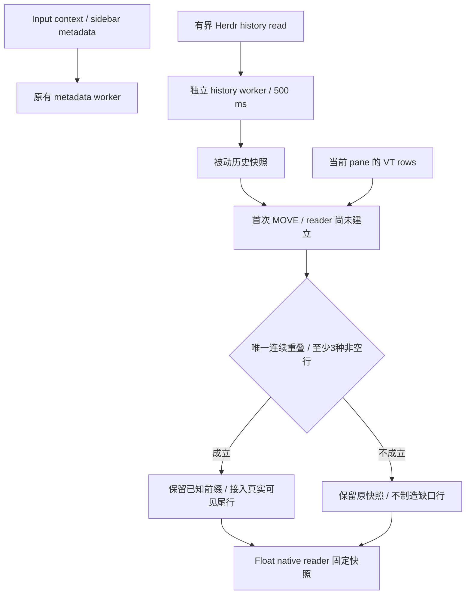
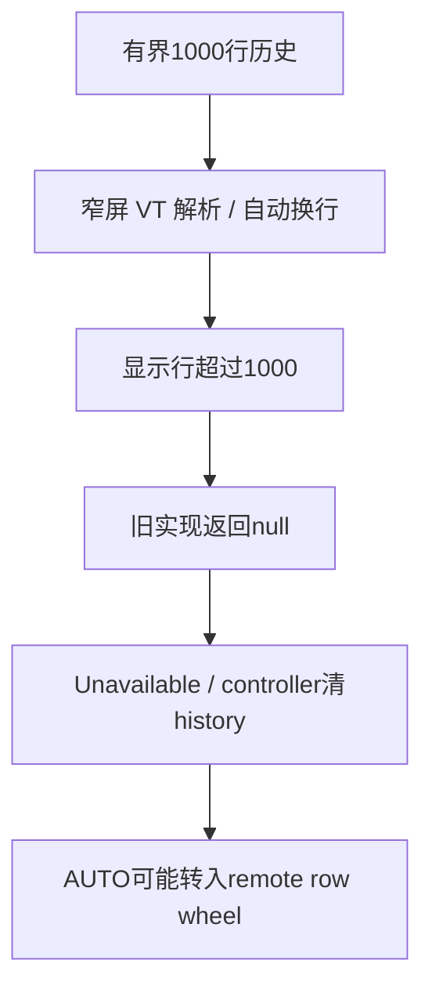

# Native scrolling for transcript panes inside Herdr

## 2026-11-07: long wrapped history and grouped desktop sidebar

The user's new 37.857-second recording still contains both continuous motion and
approximately three/six-row steps. Previous ten-round Mosh evidence covered fresh
200-line conversations, not existing rich conversations with grouped desktop
navigation. That evidence does not establish stability of the reported workflow.

Two additional failure paths are now reproduced and repaired:

- `parseHerdrHistoryRows` previously rejected an entire valid capture when up to
  1,000 raw lines rewrapped into more than 1,000 physical rows. A read of the actual
  conversation produced 1,461 physical rows at 41 columns and returned null. It
  now retains the newest 1,000 physical rows. Raw-row, byte and geometry limits
  remain enforced; this does not implement older-history paging.
- Herdr's grouped desktop sidebar uses a separate collapse control rather than
  the classic continuous vertical rule. Passive logs from 21 real Fold gestures
  retained 248 history rows but rejected their projection (`88x34` outer grid,
  `62x33` source), selecting remote mouse scrolling. `HerdrNavigationChrome` now
  recognizes the separate one-cell collapse control together with exactly one
  independent top/bottom tab strip. Projection still requires exact surface
  dimensions; a width difference alone cannot establish navigation geometry.

Both changes have failing-before/passing-after JVM regressions. The physical
controlled recovery class passed all 12 methods on the authorized S10e, including
wrapped history, grouped sidebar pixel stability, fractional motion, existing
input paths and zero wheel reports. Debug builds log one text-free route summary
per classified gesture, including source and detected chrome geometry; no terminal
body, host, credential, network telemetry or analytics is added.

A strict actual-Mosh landscape check with the current Herdr executable correctly
projected grouped navigation and entered the native reader on the first gesture
(`75x9` outer, `49x8` pane, projection `(26,1)`, wheels zero at that point). However,
its 200-marker ordered-history assertion failed: the 103-row capture contained
only a subset. This remains RED; native route alone is not a passing end-to-end
acceptance. An earlier fixture used a different executable also labelled 0.9.5,
which did not support grouped navigation; its separate failure is retained.
Neither run proves stable repeated scrolling of the user's existing multi-tab
workflow. The landscape missing-history origin remains unconfirmed.

No database/schema/dependency, global Herdr configuration, current user pane,
rendering physics or per-row Compose state changes are made. Exact artifacts,
final verification and deployment results are kept in the canonical living
record and `build/scroll-user-red-20261107/`. The broader acceptance remains open.

## 2026-11-07: continuous ownership across late history and partial chrome frames

The user's recording alternates between continuous pixel motion and jumps of
approximately three or six terminal rows. Controlled production-View regressions
reproduce two ways native ownership could be lost: history delivered between
`ACTION_DOWN` and the first move did not initialize the native gesture, and an
incomplete remote navigation redraw made a previously valid projection disappear.
An already remote gesture could then change to native halfway through its moves.

`FastTerminalView` now initializes native touch tracking at DOWN in a confirmed
Herdr session even if its first snapshot is still arriving. The original DOWN
coordinates decide whether a subsequently available source contains the gesture.
Tracking ends on UP/CANCEL or remote classification. Once a gesture is classified
remote, it remains remote until the next DOWN; it cannot mix wheel reports with
local pixel motion. Initial absent/unsupported history still uses the established
remote policy. This change does not manufacture history or promise native motion
before a real source is available.

An established native reader retains its verified projection through an
incomplete chrome frame only while pane identity, raw source geometry, terminal
grid and visibility remain compatible. Both an older pinned reader and the latest
overlay waiting for a nonzero remote offset are protected. Idle panes do not
inherit that placement. A valid changed projection, resize, replacement pane,
source removal or covering switcher still invalidates the reader. A successful
read from another client's incompatible grid cannot replace the reader's source
merely because a partial chrome frame made the pure projection check fail.
Projection caching stays on the View thread; background publication consults
existing source identity and reader flags without mutating that cache.

The original Float drag, OverScroller physics, captured row ordering, 1,000-row
history limit, explicit Remote mode and fullscreen Codex/Pi fallback remain.
No direct dependency, persisted schema, host configuration or new network feature
is added. Controlled simulator and current actual-Codex history-source evidence
are recorded in the canonical living investigation; they do not replace its
physical old-phone and user acceptance requirements.

## 2026-10-31: stable cached readers and links in native history

User RED: smooth scrolling still falls back to row-based movement in several
situations, and Obsidian links cannot be tapped while reading native history.
The nullable capture result conflated a failed read with confirmed history loss.
The native reader also consumed taps without link dispatch, and the VT parser
discarded `obsidian` OSC 8 metadata before it reached the reader.

`HerdrHistoryRead` now separates Available, Retry and Unavailable. SSH and Mosh
preserve that distinction through their existing authenticated side channels.
Transport/read errors, changing content revisions, and inconsistent resize/client
heights are retryable. A cached source is retained only for the verified same
target, a matching foreground identity, or the existing pinned reader when no
new identity is known. Missing panes, unsupported live panes, changed pane/
terminal identity and actual invalidation still release the source. A pinned
snapshot keeps its already captured rows if live history resets; an idle
screen-only pane still cannot claim native scrolling.

A successful read of the same pane at another client's incompatible grid no
longer replaces a snapshot that still projects correctly into this client's
live chrome. `projectHerdrHistory` performs the same bounds checks used by the
renderer; no grid is stretched or invented. Cancellation stops touch/fling
without discarding pinned pixels. Once a one-finger gesture is owned natively,
remaining MOVE/UP events cannot fall through to remote wheels after a source
invalidation. These changes replace the earlier one-request publication guard.

`HerdrHistoryViewport` supplies the existing link resolver with snapshot rows,
generation-scoped anchors and the reader's Float pixel position. Hit testing
subtracts the pane/sidebar/header offsets and rejects points outside the pane.
A short stationary history tap dispatches an allowed link locally; dragging,
cancellation, long holds and the first tap catching a fling do not open links.
Non-link taps preserve reading and do not click the hidden live terminal.
Both direct and buffered input use this path. Plain/wrapped Obsidian URLs and
OSC 8 targets retain their original URI.

The VT OSC 8 parser now retains `http`, `https` and `obsidian`, matching the
existing external-open allowlist. The original URI length limits, explicit
user gesture and open-policy validation remain. `file`, `javascript` and other
schemes remain rejected. No dependency, network feature, host configuration,
persisted schema, tmux change or per-row Compose state is introduced. The
1,000-row history cap remains; an initial absent or unsupported history source
does not gain fabricated local history.

Validation: JVM coverage includes repeated retries, definitive
invalidations, client-grid changes, live-history resets, fractional link bounds,
wrapped links and pinned-row identity. A first isolated API-35 controlled native
run passed 16/17 methods and failed actual history-link dispatch. The added
ANSI-history test also failed before the parser fix, confirming the lost OSC 8
metadata; those red logs are preserved. After repair, both controlled classes
passed all 17 methods on the isolated API-35 emulator `emulator-5586` in 37.927s,
including native tap/cancel/fling behavior, first-gesture publication and
Obsidian link dispatch in direct/buffered modes. Exact app and test APK hashes
matched the final build. This is fake-transport UI evidence, not actual-Codex or
physical smoothness acceptance.

Final source gate passed: app/API/core JVM1195/11/8 with zero failures/errors/
skips, debug/release lint/builds, AAB and Android-test compilation, 450 tasks in
183s. Exact instrumentation membership and 11 host contract tests passed;
unchanged 141-test tooling evidence was reused. All 697 verification input
hashes remained unchanged. Evidence: `build/herdr-smooth-followup/`.

Completed APK SHA-256
`b3cf259a82d70358e0e391690f1b56d37810863a687dfed7331d0a05a099a8d8`
was full-installed with `--no-incremental -r` on freshly resolved/model-verified
SM-F976B `adb-RFGL80WYDZW-QnawRi._adb-tls-connect._tcp`. Cold launch Status ok
(802ms), MainActivity top-resumed, keyguard not showing and installed hash match
were verified. No automated fold tests or injected gestures ran. Authorized
old-phone acceptance remains deferred; user confirmation of the real workflow
and the broader Definition of Solved remain open.

## 2026-10-31: preserve the first reader across an older idle result

The user clarified that movement advances by rows. Passive observation of their
own gestures on the verified APK found fractional native positions followed by
loss of the raw source and pinned reader. A later attached-view sample also
showed a correctly projected desktop pane and stable fractional reading. This
does not establish that every reported gesture followed the same route, or why
each remote capture failed. The earlier plus-control inference from heap string
decoding is not established; no tab-detector change is made in this follow-up.

The earlier repair reproduced a publication race: a full idle capture starts before a
gesture, the user adopts the existing snapshot, and the old capture returns null
after failing consistency checks. Publishing that null unconditionally destroys
the newly pinned reader. The earlier `publishHerdrHistoryCapture` discarded that
older null result only when the same source was still current and a pinned
reader had started since capture began. It has now been replaced by the typed
read/publication policy above; that one-shot method is no longer in the source.

That earlier guard still cleared the source after a failed pinned read. The
current typed policy retains it on a retryable failure while preserving actual
replacement, live return/input and disconnect invalidation. Screen-only live
panes do not gain native ownership. Float motion and the history cap are retained.

The new JVM race test failed before repair and passes afterward; the companion
test preserves release/replacement/disconnect behavior. The controlled native
regression blocks an idle read, performs the first gesture, releases a failed
result and requires the subsequent pinned poll to preserve reading with no
remote input. It is compiled only; old-phone execution remains deferred. Shared
source verification passed: app/API/core JVM 1187/11/8, zero failures/errors/
skips; debug/release lint/builds, AAB and Android-test compilation (450 tasks,
143 seconds). The unchanged prior 141-test tooling gate was reused; the changed
instrumentation contract passed exact membership and all 11 host contract tests.
All 696 verification input hashes remained unchanged during the final build.

The completed APK SHA-256
`7886f62945834b704532879ff8cacf6c35cd9ceb21eabb93acd80b3d77d4bcc4`
was full-installed with `--no-incremental -r` on freshly resolved/model-verified
SM-F976B `adb-RFGL80WYDZW-QnawRi._adb-tls-connect._tcp`. Cold launch returned
Status ok (857 ms), MainActivity was top-resumed with keyguard not showing, and
the installed hash matched. Evidence: `build/herdr-smooth-followup/`.
No automated fold tests or injected gestures ran. User confirmation of the
completed repair remains pending; broader smooth-scroll acceptance stays open.

## 2026-10-31 follow-up: user smoothness remains red

The user reports that scrolling still feels unsmooth. Do not treat the coordinate
repair or its JVM gates as physical smoothness acceptance. Passive inspection
found that a separate installation at 18:04:25 had replaced the verified APK
with SHA-256 `4479110b3ba06c1fbd24219fc5cbb8f6330021399b38128c25ad00044f96665b`.
That is an attribution problem, not proof that replacement alone explains the
reported movement.

Two passive samples of that replacement had no active native reader; one had
no raw history and another retained 191 raw rows. Its top-row runs did not match
the existing separate three-cell plus-control assumption. The exact failing
gesture was not observed, so no additional detector or fling patch was made.
Only scalar state was retained; temporary raw heap files were removed.

The unchanged, previously verified `91bb07f9…7544f` APK was full-installed again
on model-verified SM-F976B and cold-launched successfully. Its installed hash
was independently rechecked. The phone subsequently became dozing/locked,
preventing renewed foreground/workflow confirmation. No gestures or tests were
injected on the fold. Prior local gate evidence remains valid for the unchanged
build inputs; actual route, drag/fling behavior and user acceptance remain open.

## 2026-10-31: map client-owned chrome before native scrolling

User recording `3cc2febe-aa63-4c79-adc2-42417f74d156.mp4` shows unfolded
desktop history covering the left navigation, while the far right scrolls by
remote rows. The folded mobile workflow was reported working. Herdr 0.9.1's
`pane layout` reports a server surface rooted at `(0,0)`; its client separately
positions that surface after its sidebar and top/bottom tabs. Those raw API
coordinates must not be used directly as Android drawing or touch bounds.

`HerdrPaneHistory` now retains the API area as `surface`, checks pane containment,
and invalidates snapshot reuse when the area changes. `HerdrHistoryProjection`
maps that raw snapshot into this client's live chrome before both reader updates
and gesture hit testing. The existing `HerdrNavigationChrome` boundary checks
identify the desktop sidebar and top/bottom tab row; the mobile live Switch
header contributes two rows. The projected pane must exactly match the API
surface dimensions. A smaller server surface is never placed at the screen
origin when client chrome is unknown, covered or mismatched. Existing
outer-coordinate adapters remain supported.

The projection caches by immutable frame/snapshot identity and terminal size.
The raw snapshot remains available to the background capture adapter, so a
translated reader does not trigger another history download. Split offsets are
added once. Canvas clipping, Float drag, OverScroller fling/catch, pinned output
and bounded history remain the existing implementations. No new dependency,
transport, host configuration or tmux change is introduced.

Verification: the original projection failed five of six new JVM tests; all
six pass after repair, along with the focused Herdr/controller regressions.
`scripts/verify-android.sh` passed: 141 tooling tests, app/API/core JVM
1185/11/8 with zero failures/errors/skips, debug/release lint/builds, AAB and
Android-test compilation (450 tasks, 232 seconds for Gradle). Build/verification
inputs remained unchanged. Evidence is in `build/fold-herdr-scroll/`.

The production-view regression adds rightmost-column native routing with zero
remote input and pixel equality of the sidebar. It compiled; execution on an
authorized old phone is deferred at the user's request. These fixtures do not
establish real Codex physical smoothness.

The completed debug APK SHA-256
`91bb07f9cffbab421e664ea9d0dffc8a559319f7a9981802b0a6d593f937544f`
was full-installed with `--no-incremental -r` on model-verified SM-F976B
`adb-RFGL80WYDZW-QnawRi._adb-tls-connect._tcp`. Launch returned Status ok;
an independent follow-up confirmed MainActivity top-resumed, keyguard not
showing, and the installed APK hash matching the artifact. No fold tests or
gestures ran. Actual unfolded-workflow confirmation remains pending.

## 2026-10-26: keep the reader after a tap

User recording `48c56aa7-5cd0-463c-a626-0851437a8b56.mp4` shows a history
viewport returning to latest after a touch. `HerdrNativeScroll.ACTION_UP` used
to clear a caught reader whenever the gesture had not crossed touch slop. This
also discarded history when lifting the finger after catching a fling.

A consumed reader tap now retains the snapshot and exact Float pixel anchor.
The existing ACTION_DOWN fling interruption, sub-row drag, release fling, and
scroll-to-live handoff remain in place. Taps inside history remain local and
do not click unseen live controls. Regression coverage includes repeated taps
with sub-slop jitter, updates while pinned, catch followed by finger-up, and
a subsequent fractional drag and live-bottom return. The production-view
controlled-transport test also checks taps in direct and buffered input modes.

Verification: shared `scripts/verify-android.sh` gate passed (141 host tooling
tests; app/API/core JVM 1174/11/8 with zero failures/errors/skips; debug/release
lint/builds, AAB and Android-test compilation; 450 Gradle tasks in 167 seconds).
The initial attempt failed on `/tmp` quota; moving temporary files to a short
disk-backed directory also avoided a pre-existing tar test's 100-byte link-path
limit. Both environmental failures are retained in `build/smooth-history-tap/`.
No production or test assertion was changed to bypass them.

The new native regressions are compiled but UNRUN: neither authorized old phone
is connected. Full non-incremental installation on model-verified SM-F976B
`adb-RFGL80WYDZW-QnawRi._adb-tls-connect._tcp` succeeded; cold launch returned
Status ok. APK SHA-256: `ef2967b5cd00de920c8f01b2d5cd6f0f5ac25a20de4d66b88f8f1b9db15d237f`.
Foreground verification is BLOCKED by keyguard (`showing=true`,
`inputRestricted=true`); MainActivity is paused. No fold tests or injected terminal
gestures ran. This bounded tap repair does not close actual-Codex acceptance.

## 2026-10-07: Pi history support and per-tab investigation

The native reader previously accepted only `agent=codex`. It now also accepts
`agent=pi` when passive terminal history exists. A reported
`max_offset_from_bottom=0` prevents native ownership before reading ANSI output:
wrapped visible rows must not be mistaken for older history. Fullscreen Pi in Auto mode uses the Page Up/Down input path after user feedback
confirmed PGUP works where swipes do not. Confirmed foreground Pi, zero terminal
history, stable pane geometry, an output-area gesture, and a live viewport are
required. Each swipe direction sends one page key; finger-up emits no synthetic
fling or repeated keys. Explicit Remote mouse mode retains mouse-wheel routing.
Two-finger local overrides and mobile navigation overlays retain their routes.
Codex screen-only panes retain the negotiated remote-wheel route.
Other mouse applications retain their existing route.

User RED: personal-brain Pi tab 4 does not scroll; tab 1 does. Read-only host
inspection identifies wK:p4 and wK:p1, both running the installed Pi 1.0.4 binary
and both reporting zero terminal scrollback. This does not establish a difference
in runtime UI mode or prove the Android swipe reached the failing Pi process.
Pi's installed documentation describes fullscreen as the default and regular mode
as the mode that uses terminal scrollback. No global Pi setting or existing
conversation was changed. Regular-mode native support and controlled wheel
routing coverage do not prove this per-tab user issue resolved. The user confirmed PGUP moves older output in the failing tab, establishing an
input-path difference without proving why that Pi process rejects mouse wheels.
The paging fallback is discrete movement, not native fractional drag/fling.
Actual failing-tab user acceptance remains open.

Verification: 1,158 JVM tests, lint, debug/release builds and test compilation
passed. Eleven controlled native gesture methods passed on USB SM-S911B
`RZCW81JZ9CP`, including fullscreen Pi paging in direct/buffered modes and
explicit Remote mouse routing. The completed APK
`ffbad200f7b6e9acee0f641c48ddd9744a5aa5549badd865e6ff18ad9ba0e1d5`
was full-installed and launched on model-verified SM-F976B; MainActivity was
top-resumed. No fold tests or injected gestures ran. Evidence: `build/pi-scroll/`.
These results do not establish actual-Pi fullscreen native smoothness.

## 2026-09-29: fullscreen Codex consumes gestures without native history

User RED: all Codex panes in Mosh → Herdr on the fold stop scrolling; agy still
scrolls. The terminal itself shows `Back to bottom` / `Esc`. Host Codex is 0.159.0;
Herdr remains 0.8.2 (installed September 10, no later package upgrade recorded).
[Codex's official changelog](https://learn.chatgpt.com/docs/changelog) records
fullscreen transcripts becoming the default in 0.157.0 on September 25.

Host pane metadata reports `max_offset_from_bottom=0`, `offset_from_bottom=0`,
`viewport_rows=17` for the observed Codex panes, versus 60 older rows for agy.
The production `recent --format ansi` read returns only 16–17 rows for Codex
panes w6:pF, wD:p7 and w9:pB. This is a visible screen, not native history.
The old capture accepts it, pads it to the pane height, and enables the native
gesture handler even though its scroll range is zero. That handler consumes
MOVE/UP, preventing the live application from receiving negotiated mouse wheels.

The repair rejects snapshots with no rows above the visible pane. Existing
bounded native history retains its fractional scrolling, fling and pinned boundary;
this does not switch a native reader to remote wheels at its cached oldest row.
For a screen-only pane, the existing remote mouse policy can deliver the gesture
to Codex. This restores gesture routing, **not native smoothness for fullscreen
transcripts**. Passive styled history from that UI remains unavailable through
the observed Herdr ANSI interface. Codex's installed help documents
`--no-alt-screen` for inline mode with terminal scrollback; no user configuration
or running conversation was changed to force that mode.

The screen-only host regression failed before the fix. A production native-view
test covers delivery of both older/newer wheels with no local overlay; existing
zero-wheel native-history tests remain intact. Device execution and completed
fold deployment are pending: no authorized phone appears in `adb devices -l`.
Wireless fold discovery advertises an endpoint but connection fails. No phone
tests or gestures were executed. This is not actual-Codex physical acceptance.
One diagnostic text-format read of the existing numbered-row pane returned a
longer transcript; Herdr can actively harvest alternate-screen text using wheel
input, so that result is excluded from passive-history evidence and is not used
by this patch. No further text harvesting was attempted.

Verification for the September 29 candidate: `scripts/verify-android.sh` passed;
125 tooling tests and 1,128 JVM tests passed, lint and debug/release builds passed,
and the new Android test compiled. Herdr history tests: 17/17 passing.
APK SHA-256: `63c7f780df1f0eb99511b4290454df34fa3f8b529065c6d147846c7c914c9273`.
Evidence: `build/codex-scroll-regression/`. Device tests and deployment remain
unavailable; this candidate has not been installed on the fold.

Earlier bounded-reader implementation and deployment history follows.

## Bounded implementation approved by the user

The user explicitly accepted Herdr's current 1,000-row read limit and requested implementation
and installation. App-selected Herdr sessions now fetch the focused Codex pane through the
existing authenticated SSH side channel, including the side channel retained by Mosh. The app
validates pane/terminal identity, layout, scroll metrics and content revision around each bounded
ANSI read. It does not introduce another connection, executable helper or library dependency.

A native Canvas overlay clips history to that pane's rectangle. One-finger vertical drag uses a
Float viewport, fling uses Android OverScroller, and touch catches fling. The reader pins its
snapshot while output continues; background checks validate identity/layout without refetching
the transcript during reading. Tapping inside the reader stops any fling and preserves the pinned history position. Typing returns to live output; dragging to the live bottom also releases the reader when the remote pane is at bottom. The recent-history limit is documented here without interrupting gestures with a toast.
Explicit Remote mouse mode retains the existing input route.

This implementation supports Herdr sessions selected in the app and panes reported by Herdr as
Codex or Pi with passive terminal history. A manually launched, unidentified Herdr client does not gain this adapter. Capture failures,
unsupported metadata and geometry mismatches do not display guessed history. History beyond the
bounded read remains unavailable in this native reader; this is not full tmux history parity.

Host unit coverage includes all 1,000 ordered styled rows, bounds, exact-session command quoting,
changed content/identity rejection, fractional movement, the oldest cached row, existing remote
offsets, reader stability during output, and pane/layout/disconnect invalidation. Physical gesture
acceptance remains pending on the authorized old phone, which was absent during this session.

## Requested behavior

The user confirmed that the target is Codex terminal output inside Herdr, not Herdr's chat or
workspace lists. The desired behavior is the existing native tmux experience: fractional drag,
Android fling and touch catch, ordered older history, and a stable reading position during output.

## Installed-version evidence

On 2026-09-11 the host has Herdr 0.8.2-1, socket API protocol 20. An isolated headless Herdr
server was started with a temporary configuration directory and socket. A disposable pane emitted
5,000 numbered shell lines. No existing Herdr workspace or phone was used by this probe. The
server was stopped and its temporary directory removed afterward.

Request: `pane.read`, `source=recent`, `lines=10000`, `format=text`.

| Observation | Result |
| --- | --- |
| Numbered lines emitted | 5,000 |
| Numbered lines returned | 998 |
| First returned marker | `HERDR_PROBE_04003` |
| Last returned marker | `HERDR_PROBE_05000` |
| Response `truncated` | `true` |
| Response `revision` | `0` |
| Pane `offset_from_bottom` | `0` |
| Pane `max_offset_from_bottom` | `4966` |
| Pane `viewport_rows` | `39` |

This is a host API-capacity experiment, **not** actual Codex or physical smooth-scroll acceptance.
The initial probe incorrectly expected an `ok` envelope field and failed before creating its
workspace. The corrected probe used the API's `result`/`error` envelope and produced the result
above. Both disposable servers were stopped.

The installed schema provides pane identity, layout rectangles and scroll metrics, but its read
request has no older-row range or continuation cursor. The observed response contains at most
1,000 physical rows, including shell/prompt rows. Increasing the requested count does not expose
the older rows that the server still retains.

Source corroboration:

- [Herdr snapshot reader](https://github.com/herdrdev/herdr/blob/v0.8.2/src/app/api_helpers.rs)
  clamps the requested line count to 1,000.
- [Herdr socket API documentation](https://github.com/herdrdev/herdr/blob/v0.8.2/docs/next/website/src/content/docs/socket-api.mdx)
  documents pane reads, layout and scroll metadata.
- [Herdr alternate-screen reader](https://github.com/herdrdev/herdr/blob/v0.8.2/src/server/alt_screen_read.rs)
  includes a wheel-driven history harvesting path. Do not treat that path as a passive capture
  equivalent to tmux `capture-pane`; its behavior was not exercised by the installed-version probe.

## Why an Android gesture-only patch is insufficient

The current Android Auto router sends remote wheel reports for a non-tmux session that requests
mouse tracking. Its remote branch moves in terminal rows and deliberately does not synthesize a
remote-wheel fling. The installed phone's exact first-gesture route has not been measured, so this
remains the source-level explanation rather than physical route evidence.

Tmux solves this by supplying real pane history off-thread, allowing the existing native renderer
and Float viewport to move without remote wheel reports. Herdr needs an equivalent history source.
Routing its gestures locally before that history exists would scroll the outer application screen
or expose an incomplete transcript. Wrapping Herdr in tmux would capture the outer pane, not
automatically grant access to Codex history held inside Herdr.

## Remaining work for full history parity

1. Herdr must expose passive, bounded history pages for an exact pane. A response needs pane and
   terminal identity, history epoch/revision, dimensions, first/last row coordinates, truncation
   information, and physical rows with styles and wrap metadata. Reading must not move the remote
   viewport or send keys/wheels to Codex.
2. Bind capture to the Herdr session attached to the exact authenticated transport. Use the pane
   under the initial touch and its matching layout; never select the latest arbitrary session or
   assume the server's focused pane belongs to this client. Invalidate on detach, pane switch,
   layout/size change and replacement of the pane's terminal.
3. Fetch and parse bounded pages through the existing authenticated side channel, outside the
   Android render and gesture loops. Preserve the established row-work and memory bounds.
4. Reuse native rendering, a Float pixel viewport and Android fling inside the selected pane's
   rectangle. Keep Herdr's surrounding controls and other panes in their live positions. Match
   the visible pane rows before the first transition so it does not jump.
5. Prefetch older pages before reaching the cache boundary and preserve the exact pixel anchor
   when prepending. Distinguish the true oldest row from a local safety limit. Never switch an
   in-progress native gesture to remote wheel input at that boundary.
6. Preserve the recent Herdr tap/typing support, explicit remote mouse mode, ordinary direct
   SSH/Mosh history, and all current tmux contracts. Include SSH and Mosh lifecycle handling.

## Acceptance and current limits

Run actual Codex inside Herdr on the authorized old `SM_S911B`. Ask Codex for all 200 numbered
markers, verify their full order, then exercise the first real gesture without waiting for an
internal ready flag. Require sub-row movement, zero outbound wheels, post-release motion, touch
catch, stable reader position under new output, seamless live-bottom return and history beyond
one initial page. Test pane switching and retain the existing direct/tmux regression matrix.

Unit tests, lint and an Android build must pass for the eventual implementation. Only then install
and launch the completed APK on the foldable without tests, and obtain the user's visual result.

At the initial investigation's device enumeration, only wireless `SM_F976B` was connected; the
authorized old phone was absent. The initial investigation performed no phone test, install or
gesture. The later bounded implementation and its deployment are recorded separately below.

## Bounded implementation verification

Both `test lint assembleDebug --max-workers=2 --no-configuration-cache` runs passed. The final
run completed 166 tasks in 54 seconds; all eight new Herdr unit tests passed, with zero failures,
errors or skips. The follow-up fixed a gesture-state reset during live redraws before the native
drag threshold was reached. Logs are retained in `build/herdr-native-scroll-evidence/`.

On 2026-09-11, ADB enumeration resolved wireless `192.168.0.33:34961`; `ro.product.model` was
verified as `SM-F976B` before installation. The completed debug APK SHA-256 is
`621abcf0d518eae3f912ec1fb25571bd14cdcb632133d37e584a83f85735f1c1`. Streamed `install -r`
succeeded. `am start -W` returned `Status: ok`, `LaunchState: COLD`, and MainActivity was
`topResumedActivity`; keyguard reported `showing=false` and `inputRestricted=false`.

No tests ran on the foldable. Physical old-phone drag/fling and actual Codex acceptance remain
unrun because SM_S911B was unavailable. User confirmation of the installed bounded reader is
pending; neither this result nor the host API probe closes full tmux-equivalent acceptance.

## 2026-09-11: viewport alignment and first-login sizing

User screenshots showed a fragment of old output above Herdr's numbered tabs and an undersized terminal on first login until the keyboard was expanded and hidden. The viewport now uses the same whole-row height as the reported PTY grid. A regression demonstrates that an 807-pixel available area with 20-pixel rows previously exposed history row 999 above live row 1000; the aligned 800-pixel viewport starts at row 1000 and still supports fractional history movement.

The native view reschedules terminal sizing on reattachment, skips unmeasured geometry instead of reporting a one-cell terminal, and resends the latest grid when the connection becomes ready. Renderer-profile changes discard history-reader pixel geometry. Idle Herdr snapshots reuse their capture when pane identity, geometry, revision and remote offset are unchanged, avoiding repeated 1,000-row downloads. Recent history remains supplied by Herdr and bounded to 1,000 rows.

Validation: `./gradlew test lint assembleDebug --max-workers=2 --no-configuration-cache` passed in 59 seconds (166 actionable tasks). HerdrPaneHistoryTest: 9 tests; TerminalGridGeometryTest: 3; SshSessionRepositoryTest: 39; all zero failures/errors/skips. Evidence: `build/herdr-native-scroll-evidence/layout-gates.log` and `layout-deployment.json`.

Deployment at 2026-09-11T00:10:59+00:00: verified model SM-F976B at exact serial `192.168.0.33:34961`, installed debug APK SHA-256 `b7d154f16c57bdb09f4b604fbfbd7916a705f403079db0a2fac92e8ce6b14759`, launched successfully, and confirmed MainActivity as topResumedActivity with keyguard not showing. No device tests ran on the foldable. The authorized SM_S911B was unavailable. Actual first-login geometry, gesture smoothness, route/reason, outbound wheel count and full ordered real-Codex history remain unmeasured for this build; user confirmation is pending. No tmux acceptance claim is made.

## 2026-09-12: history boundary and repeated toast

User red evidence: https://photos.app.goo.gl/zY5Vj9hY3AFDLu2cA reports repeated boundary jumps
and shows the 1,000-row toast over the Herdr terminal. Source inspection found that either drag
direction opened a cached snapshot and returning to bottom kept that snapshot until release.
The reader now opens only for an older-history drag, clears immediately at live bottom, and
consumes the remaining drag without reopening history or starting a fling on the cleared reader.
The repeated toast and its unused string are removed; the bounded 1,000-row capture is unchanged.

All 12 Herdr unit tests pass, including new repeated-live-bottom, immediate-bottom-return and
repeated-oldest-boundary regressions. Full `test lint assembleDebug --max-workers=2
--no-configuration-cache` passed in 44 seconds, 166 tasks. Evidence:
`build/herdr-boundary-evidence/gates.log`. Existing direct SSH/Mosh and tmux tests are preserved.
The authorized SM_S911B is absent, so real gesture, fling and actual-Codex acceptance have not
been rerun. No tests run on the foldable. Deployment evidence is recorded in
`build/herdr-boundary-evidence/deployment.json`; user verification remains pending.

Completed debug APK `4811639a18728d7e6c73a0367ea383c5ca28b57793ab2b59ac6071101d0c139b` installed successfully on model-verified `SM-F976B` at exact serial `adb-RFGL80WYDZW-QnawRi._adb-tls-connect._tcp`. Cold launch returned Status ok; MainActivity is topResumedActivity. No fold tests. User real-workflow confirmation remains pending.

## 2026-09-12: user acceptance and gesture regression coverage

The user confirmed that the boundary fix works on build `4811639a…c139b` and requested
regression protection. `HerdrNativeScrollTest` now dispatches Android MotionEvents through the
production gesture handler for repeated live-bottom swipes without opening history/flinging,
fractional reader movement and source-refresh stability, immediate bottom return with no
same-gesture reopening, and repeated oldest-boundary gestures retaining all 1,000 ordered rows.
These complement the 12 host Herdr capture/viewport tests. The native tests are included in the
explicit full-suite inventory; execution awaits the authorized old SM_S911B. They are synthetic
event regressions and do not substitute for actual-Codex physical acceptance.

2026-09-12T20:37:54.196444+00:00 — Herdr regression/uniform-buttons follow-up complete: unit tests app/API/core 1068/11/8, zero failures/errors/skips; lint/debug/Android-test builds GREEN (264 tasks, 1m41s); test inventory GREEN6/6. Three new native MotionEvent tests compiled but not run because authorized old SM_S911B absent. Completed APK 534e91c5d0f9201c5e1cde5f96c4b1fe415071a48ba9f822c11c79e59c006fd5 installed on model-verified SM-F976B at exact serial adb-RFGL80WYDZW-QnawRi._adb-tls-connect._tcp, cold launch Status ok, MainActivity topResumedActivity. No fold tests. Herdr boundary already user-confirmed; broader tmux physical acceptance remains open. Evidence build/herdr-regression-evidence/.

## 2026-09-12: mobile spaces/tabs switcher owns its swipes

User red: on a phone-sized Herdr layout, opening **switch** and swiping the spaces/tabs
panel displayed cached terminal history instead of scrolling the panel. Herdr 0.8.2 retains
its focused-pane rectangle underneath that full-screen mobile panel, so pane geometry alone
cannot grant the native reader ownership.

For the known two-row mobile layout, native history now requires the live **switch** affordance
in the right-hand header. The panel's **close** / **×** header, missing header, or mismatched
width leaves the gesture with the existing remote-input policy. This bounded check reads the
live VT frame, without another capture, remote command, or per-cell Compose state. Opening the
panel clears a pinned reader/fling; a swipe begun on the panel cannot start native history
partway through if the panel closes. The next swipe over live terminal output can read history
again. Desktop Herdr, direct SSH/Mosh and tmux routing remain unchanged. Unknown future mobile
header formats conservatively retain remote scrolling.

Host regressions cover mobile/desktop geometry, wide-character labels, open/close redraws with
an unchanged history snapshot, and ordinary-terminal exclusion. The new native-view regression
checks outbound panel wheel reports, no cached reader, gesture ownership through a close redraw,
zero-wheel native scrolling on the next gesture, and reader invalidation when the panel opens.
It is synthetic regression coverage, not actual-Codex or physical smoothness acceptance.

2026-09-12T22:03:21.147407+00:00 — Herdr mobile switcher repair on base 93f6a28 plus preserved unrelated changes: user RED reports panel swipe opening terminal history. Live two-row header now gates native history; panel gestures stay on existing remote mouse policy (AUTO_REMOTE_MOUSE_TRACKING when negotiated), remain remote through a close redraw, and a new live gesture regains native history. Host app/API/core units GREEN1070/11/8, zero failures/errors/skips; full test/lint/debug/Android-test build GREEN264/1m21s, final test timing refinement lint/Android-test build GREEN155/9s, inventory GREEN6. Completed APK 1c54f296da4e506e9db4ebde923f7fcbdd521f01e7203102922179e2a39d26d0 installed and MainActivity top-resumed on model-verified SM-F976B at exact serial adb-RFGL80WYDZW-QnawRi._adb-tls-connect._tcp; no fold tests. Authorized old SM_S911B absent; native-view event test compiled but UNRUN. Actual physical route/reason and outbound wheel count UNMEASURED; tmux pane metadata not applicable to this Herdr-only change. No new actual-Codex or tmux smooth-scroll acceptance. Evidence: terminal-spike/build/herdr-switcher-evidence/.

## 2026-09-26: returning from native history to a remotely scrolled pane

User recording: https://photos.app.goo.gl/A6KafMqjod4er5bt8. The user confirms the path is
Mosh → Herdr → Codex; other transports are not established comparisons. In the recording,
the input briefly appears near the bottom around 3 seconds, then older content returns;
the keyboard toggle around 9–11 seconds reveals the input again. The pane moves while
Herdr's sidebar remains largely fixed. The recording alone does not expose remote scroll metrics.

A deterministic reproduction identifies an ownership trap when Herdr reports a nonzero
`offset_from_bottom`. The native reader could still take ownership, reach the bottom of its
captured rows, then clear its overlay and reveal Herdr's older remote viewport. Further
newer-history drags were consumed without a native snapshot or any remote wheel reports,
so they could not reduce the actual remote offset. Cache reuse while reading also ignored
changes to that offset.

Capture now declines native ownership whenever the reported remote offset is nonzero, before
both idle and active-reader cache reuse. The existing remote-input route can then move the
already-scrolled Herdr pane back to its actual bottom. Native pixel scrolling resumes after
a successful zero-offset capture. This recovery may use remote row scrolling until bottom;
it does not synthesize a remote fling or change tmux ownership. No input commands are added
to the capture path, and the 1,000-row bound is unchanged.

The JVM regression was red before the change. The production capture/native-view regression
also failed on the model-verified USB SM-S911B: three newer-history drags emitted no wheel
reports and left the simulated remote pane above bottom. This device test uses a fake
transport and controlled metadata; it is not actual Mosh/Herdr/Codex acceptance. Its green
run must prove the remote offset reaches zero without an IME resize and a subsequent native
history gesture sends zero wheels. Evidence is retained in `build/scroll-bottom-evidence/`.
Actual user-workflow confirmation remains required; this finding is not proof that every
intermittent bottom jump in the supplied recording has the same cause.

Verification at 2026-09-26T10:15:38.948620+00:00: `scripts/verify-android.sh build` passed on the immutable
current-source checkout (450 tasks, 4m42s). App/API/core JVM totals: 1093/11/8, no failures,
errors or skips; preflight tooling 125 tests and exact Android test inventory passed.
The final five-method old-USB suite passed on model-verified SM-S911B `RZCW81JZ9CP`,
with installed APK hashes checked before and after. Final debug APK SHA-256:
`2c503a449e817679d640f4a6544f0ef848c1e3b293518c6a44b76bcff16ddb20`.
It was full-installed successfully on model-verified wireless SM-F976B
`adb-RFGL80WYDZW-QnawRi._adb-tls-connect._tcp`; cold launch returned Status ok.
The activity is resumed but the lock screen (`showing=true`, `inputRestricted=true`)
prevented top-resumed foreground proof. No tests ran on the fold. User unlock and
actual-workflow confirmation are pending. Concurrent changes were preserved; the
shared-checkout build was superseded by isolated verification to avoid colliding logs.

Unlock follow-up: 2026-09-26T15:19:25.200299+00:00 — Herdr bottom-return unlock follow-up: exact model-verified SM-F976B adb-RFGL80WYDZW-QnawRi._adb-tls-connect._tcp is unlocked (showing=false/inputRestricted=false), and MainActivity is topResumedActivity. Read-only checks only, no tests/install. Installed APK SHA256 773b4b00fbc150e6bffc8910c8c260fa7f709e24a4abcd6a7a923e80d81ba91a differs from this session’s verified 2c503a449e817679d640f4a6544f0ef848c1e3b293518c6a44b76bcff16ddb20 and the current shared-checkout APK; later package replacement is observed, provenance unverified. Current source retains require(offset == 0). This establishes present foreground state, not exact-artifact deployment or real-workflow acceptance.

## 2026-09-26: reject the remote-wheel recovery regression

The user reports the preceding bottom-return change appeared to help reach the input, but
scrolling became visibly row-based again. The `offset_from_bottom == 0` ownership gate and
its positive-remote-wheel test therefore do **not** satisfy acceptance. The earlier red/green
record above is retained as evidence of the rejected tradeoff, not a solved result.

Native history now remains available with a nonzero remote offset. Both older- and newer-history
gestures use the same local Float viewport and OverScroller. At the local bottom, the reader
keeps the latest pane snapshot visible while Herdr's remote viewport is still older, instead
of clearing the overlay onto that older screen. It releases normally when metadata reports the
remote bottom. No automatic keys, wheels, resize, or server mutation is used for that handoff.

An older reader pins its rows and exact pixel anchor. A reader at latest instead accepts updated
bounded snapshots so the input and subsequent output do not freeze. Capture cache reuse now
also tracks received terminal output: Herdr 0.8.2's pane `revision` describes metadata and is
not a content revision. Background refreshes invalidate an idle live capture after transport
output. A latest overlay refreshes on the existing 500 ms worker even without new Mosh frames,
because output below a scrolled remote viewport may not redraw that viewport. Pinned older
content stays stable. The same worker owns all bounded reads;
there is no capture or network work in drag/fling frames and the 1,000-row limit is unchanged.

New host assertions first failed against the rejected candidate, then passed for nonzero-offset
capture, latest-overlay retention, safe zero-offset handoff, and latest-content refresh versus
pinned pixel anchoring. The old-phone fake-transport/native-view gate now requires **zero**
remote input throughout native recovery, visible latest input, and refresh without new terminal
frames even with an unchanged API revision. A separate Android MotionEvent regression proves
3.25 px movement, post-release motion and touch catch with remote offset 6. Together with the
existing history-boundary and mobile-switcher regressions, all six device methods pass on the
model-verified USB SM-S911B. These are controlled native regressions, not actual Mosh/Codex
workflow acceptance; user confirmation on the completed fold build remains pending.
Evidence: `build/herdr-smooth-recovery/` and `build/scroll-bottom-evidence/smooth-device/`.

Final verification/deployment: 2026-09-26T15:36:36.664012+00:00 — Final APK SHA256 7ae1dca1167ecb4dce319239e1b3bbd0aa72c0d6790831312f49b6286e15c9a1: verify-android.sh build passed (unit tests, lint, debug/release builds; 450 tasks). Final controlled native/fake-transport regressions passed 6/6 on model-verified USB SM-S911B RZCW81JZ9CP. With remote offset 6, a valid bounded Herdr snapshot selects local Float/OverScroller; outbound remote wheel/input count is zero. Tests prove 3.25 px movement, fling, touch catch, safe bottom handoff, and latest-input refresh with unchanged API revision 1 and NO new Mosh frame. This supersedes the earlier output-dependent refresh description; actual Mosh/Herdr/Codex and tmux acceptance remain unconfirmed. Full non-incremental fold install succeeded on verified SM-F976B adb-RFGL80WYDZW-QnawRi._adb-tls-connect._tcp; installed SHA matches. Launch Status ok and MainActivity topResumedActivity were verified immediately after launch; a later read showed Reddit foreground. No fold tests. Evidence: build/herdr-smooth-recovery/ and build/scroll-bottom-evidence/smooth-final-device/.

Follow-up user regression (not solved): 2026-09-26T17:07:28.295522+00:00 — User RED on fold persists with exact installed APK 7ae1dca1167ecb4dce319239e1b3bbd0aa72c0d6790831312f49b6286e15c9a1: row-based scrolling begins near the input, not only at the oldest cache boundary. User adds new conversations/new speech or output can scroll smoothly. Read-only SM-F976B diagnostics (no tests, gestures or install) confirm profile auto; recovered heap state after the issue had subsided shows outer grid 88x33, viewport autoFollow=true, lineHeight=59px, Herdr snapshot x26/y1/62x32/offset0, reader inactive. This is a healthy-state sample, NOT failing-route proof. Actual failing route/reason/wheels remain unmeasured, tmux metadata N/A. Nine bounded real host Codex pane captures parse successfully (48–1000 rows); temporary local JVM diagnostic test passed and was removed. No new production patch; prior six controlled tests do not establish user acceptance. Sanitized evidence build/herdr-fold-row-regression/live-state.txt; raw heap removed after numeric-state extraction.

## 2026-09-26: letter-numbered Herdr panes lost native history

The user isolated a smooth window and a row-scrolling window in the same fold app.
Read-only state inspection showed a valid history snapshot in the smooth window and
`herdrHistory=null` in the failing window, despite Auto mode, matching terminal size,
and the outer viewport at bottom. The failing conversation is `w6:pC`; the earlier
working pane was `w6:p7`. Production capture rejected the real `pC` layout before
issuing a pane read because it required decimal-only pane numbers. Herdr public pane
IDs also contain uppercase letters. This supersedes speculation about old-window
state, content length or a need to recreate the conversation.

History and input-context validation now accept uppercase alphanumeric pane numbers.
Exact pane/tab identity, geometry, byte/row bounds and shell quoting remain checked.
Host regressions cover `pC`, multi-character numbers, numeric IDs and malformed IDs;
the two new history/context assertions failed before the fix and pass afterward.
The native device recovery regression now also exercises the real-world `w6:pC` ID.
This ID repair does not itself close the broader tmux smooth-scroll acceptance record.

2026-09-26T17:11:20.187732+00:00 — Root cause CONFIRMED for user per-window row-scroll regression. Fold read-only failing-window heap has herdrHistory=null while outer viewport autoFollow=true/grid88x33; focused real host pane is w6:pC. Earlier healthy snapshot was numeric pane w6:p7. Production capture against real focused pC returned null four times immediately after layout, before get/read. Both history and input-context parsers incorrectly required :p[0-9]+, but Herdr public pane numbers contain uppercase letters. Candidate accepts :p[0-9A-Z]+ without changing shell quoting, identity, geometry, capture bounds or gesture routing. Two new host assertions RED before fix (21 total/2 failed), GREEN after. New controlled old-phone pC integration method added alongside numeric-pane coverage; complete gates/device run pending. Later live host GREEN probe selected w9:p1 after user switched, so it is explicitly NOT actual pC end-to-end green proof. Source/live API reads are independent corroboration of the ID-format mismatch. User real fold confirmation still pending.

2026-09-26T17:14:01.818639+00:00 — Pane-ID candidate final GREEN: verify-android.sh build passed 450 tasks/2m11s; JVM app/API/core 1097/11/8, zero failures/errors/skips, lint and debug/release builds passed; exact Android inventory validated. Old USB SM-S911B RZCW81JZ9CP controlled native/fake-transport suite passed 7/7, including w6:pC offset6 older/newer native recovery, ZERO outbound remote input/wheels, visible latest input, refresh without new Mosh frames, safe offset0 handoff; separate sub-row/fling/catch and switcher regressions preserved. APK SHA256 3d41521901ff05e0b1f796fddcfe283dd9155caa04b36b5e81b5dbc1072febbe matches installed/tested provenance. Same APK full-installed on model-verified SM-F976B adb-RFGL80WYDZW-QnawRi._adb-tls-connect._tcp; launch Status ok and MainActivity topResumedActivity verified, no fold tests. Logs build/herdr-fold-row-regression/ and build/scroll-bottom-evidence/pane-id-device/. No actual Mosh/Codex gesture acceptance claimed; user to retry original letter-numbered conversation, no recreation required. Overall status remains planned/done_at none.

### User acceptance and regression protection

2026-09-26T17:15:34.392631+00:00 — User ACCEPTED pane-ID fix on installed fold build 3d41521901ff05e0b1f796fddcfe283dd9155caa04b36b5e81b5dbc1072febbe: "ok smooth now". Follow-up regression audit confirms host coverage for pC/pA1/numeric IDs, malformed rejection, bounded ordered history and pinned pixel anchor; native tests cover 3.25px drag, post-release motion, immediate touch catch, zero outbound wheel/input for pC recovery, latest-input refresh without Mosh frames, bottom handoff and mobile switcher routing. Reused unchanged-source passing evidence: full unit/lint/debug/release gate (450 tasks, JVM1097/11/8) and old USB SM-S911B seven native methods passed. Methods are present in exact Android test inventory; CI configuration validates complete API26/API35 runtime membership. Hosted CI was not run or claimed green. This confirms the specific Herdr letter-pane smoothness repair, not every item in the broader tmux Definition of Solved. No new device actions or application changes this follow-up.

2026-09-29T20:25:25.232198+00:00 — Fold deployment completed at user request. Paired through discovered wireless endpoint (pairing code not retained), resolved exact serial192.168.0.33:36121 and verified modelSM-F976B immediately before full non-incremental install. Verified APK SHA25663c7f780df1f0eb99511b4290454df34fa3f8b529065c6d147846c7c914c9273 matches the prior passing local gate. Install Success; cold launch Status ok; MainActivity topResumedActivity confirmed. No fold tests or injected gestures. Reused unchanged-source unit/lint/build evidence; old-phone regression remains UNRUN. Actual user gesture route/reason and wheel count UNMEASURED; tmux metadata N/A. User no-scroll confirmation and fullscreen smoothness remain open.

## 2026-09-29: user confirms scrolling; inline smoothness feasibility

2026-09-29T21:04:30.581337+00:00 — User confirmed the installed no-scroll fix works. Added regression tests
for exactly one older row retaining a 3.25 px local offset and for a changed
screen-only capture releasing the reader before later inline history restores it.
`HerdrPaneHistoryTest` passes 19/19. The shared build gate passes all 1,130 JVM
tests, lint, debug/release/AAB builds and Android-test compilation (450 tasks,
16 seconds). The debug APK remains byte-identical to the installed candidate.

Only the fold is connected. The compiled older/newer-wheel native-view regression
and existing zero-wheel fractional/fling/catch tests still need SM_S911B; none
were run on the fold. User no-scroll confirmation does not close smoothness.

An isolated host Herdr 0.8.2 server ran actual Codex 0.159.0 with
`--no-alt-screen`, waited for the input, and asked Codex for 200 numbered lines.
The passive `recent --format ansi` read returned all 200 markers in order,
226 physical rows, with `viewport_rows=39`, `max_offset_from_bottom=187`, and
`offset_from_bottom=0`. No gesture wheels or active text harvesting were used.
The owned server/pane and temporary configuration were removed. An initial
fixture attempt left the prompt unsubmitted because Enter immediately followed
paste; delaying submission by one second produced the verified result.
Evidence: `build/codex-smooth-followup/`.

This establishes a viable history source for the existing Android native reader
when Codex uses inline mode. It does not prove real-phone smoothness. Keeping
fullscreen requires passive styled history that the observed Herdr ANSI path
does not supply; injecting wheel events or harvesting screens cannot meet the
zero-wheel native-scroll acceptance contract. No real Codex mode/configuration
was changed. The documented per-launch compatibility option is
`codex --no-alt-screen`; [official TUI configuration](https://learn.chatgpt.com/docs/config-file/config-advanced) also documents
`tui.alternate_screen = "never"` to retain terminal scrollback.

## 2026-09-29: isolated inline Codex passes on the old phone

2026-09-29T21:43:16.068628+00:00 — Paired the authorized SM-S911B over wireless ADB, exact serial
`192.168.0.175:44387`; USB was absent. User approved testing inline mode in an
isolated session. No existing Codex conversation or global Codex setting changed.

The eight controlled Herdr native/recovery/switcher methods passed, including
fullscreen older/newer wheel delivery and the existing zero-wheel native cases.
The new opt-in `HerdrInlineRealEndToEndTest` then passed with actual Codex 0.159.0
`--no-alt-screen` inside a uniquely named, runner-owned Herdr 0.8.2 session. It
uses production SSH startup selection, passive history capture, terminal controller,
and FastTerminalView on the real phone. The phone could not reach workstation
SSH directly, so this run used SSH over an ADB TCP tunnel. It is **not Mosh
end-to-end acceptance**. The phone remained in landscape; no zoom was applied.

After actual Codex's input appeared, Codex itself generated all 200 markers. The
test waited for visible output to settle, never for native history readiness.
Before touch, row 200 was visible and row 001 absent. The first gesture acquired
the native Herdr reader; capture held 229 rows with viewport 16 and remote offset
0 (outer grid 91×17, pane width 65). Assertions proved every marker in order,
3.25 px movement, continued motion after release, immediate touch catch, and real
MotionEvent traversal to row 001. Outbound SGR wheel reports remained zero.
Herdr's reader has no generic route-reason enum; the observed route was its
active native reader backed by the passive snapshot. Tmux metadata is inapplicable.

Preserved RED evidence: the initial test had a non-void JUnit return; direct LAN
SSH timed out; a pasted carriage return did not submit the prompt. An immediate
gesture after row 200 first appeared pinned a snapshot ending at row 195. The
settled-output run retained all 200; this does not prove the immediate-output
capture lag is fixed. A later bottom assertion incorrectly inspected TerminalLine
objects rather than their text; scalar indices proved row 200 was in range, and
correcting the test oracle passed. No scrolling production code changed here.

Final shared gate passed: 1,130 JVM tests, lint, debug/release/AAB builds and
Android-test compilation; 125 tooling tests passed earlier, and final exact
Android inventory validation passed. Base `081ae4b`, existing concurrent changes
preserved. APK SHA-256 remains
`63c7f780df1f0eb99511b4290454df34fa3f8b529065c6d147846c7c914c9273`.
Evidence: `build/old-phone-smooth/`, including the eight-test result, one-test
actual-Codex result, scalar checkpoints, retained failures, and build logs.
Owned server/session, temporary SSH authorization and ADB tunnel were removed.

The same completed APK was full-installed on model-verified SM-F976B
`adb-RFGL80WYDZW-QnawRi._adb-tls-connect._tcp`, launch returned Status ok.
Foreground proof is blocked by its lock screen (`showing=true`,
`inputRestricted=true`); MainActivity is paused. No fold tests or gestures ran.

This verifies inline-mode feasibility and physical native motion for this isolated
SSH path. Fullscreen native history, actual Mosh acceptance, immediate-output
refresh behavior, and user validation remain separate open items. The opt-in
test requires `herdrE2eSession` beginning with `terminal-spike-inline-` plus the
existing `sshE2eHost`, `sshE2ePort`, `sshE2eUsername`,
`sshE2ePrivateKeyBase64` and `sshE2eCodexCommandBase64` arguments. Supply secret
arguments through ADB stdin, and create/clean up only an owned named fixture.

### Fold feedback after isolated inline test

2026-09-29T22:03:54.118926+00:00 — User RED: scrolling on fold still feels per-row. Prior isolated inline SSH green did not change existing Codex sessions or global mode; do not describe it as a delivered fullscreen fix. Read-only host focused Codex pane w6:p7 reports max_offset0/offset0/viewport17, while agy has201 older rows. This supports the fullscreen-history limitation but is not exact fold gesture attribution. No fold gestures/tests, no phone route/wheel measurement; tmux metadata N/A. User config tui.alternate_screen is unset; installed help and official advanced configuration confirm --no-alt-screen / tui.alternate_screen="never" preserves terminal scrollback. Proposed concrete change: add alternate_screen="never" under existing [tui] in ~/.codex/config.toml for subsequent launches; no current-session restart. Await user scope choice because previous authorization was isolated testing only. No new application changes or builds; unchanged prior evidence retained.

### Saved-host Mosh acceptance and Codex configuration

2026-09-29T22:38:13.541121+00:00 — Saved-host physical follow-up, base `081ae4b`, unchanged APK SHA-256 `63c7f780df1f0eb99511b4290454df34fa3f8b529065c6d147846c7c914c9273`. User authorized testing their saved host and fixing scrolling. Exact model-verified old phone `192.168.0.175:44387` / SM-S911B, portrait, saved host `100.102.70.20`, actual MOSH with app-selected owned Herdr session. Fullscreen Codex 0.159.0 reproduced RED: first reader=false, cached=0. The 70px probe reported wheels=0 but was below the remote-wheel threshold; this is not proof of smooth fullscreen scrolling. Explicit --no-alt-screen GREEN: 233 captured rows, viewport28, offset0, all200 markers in order, first-gesture native reader, 3.25px drag, fling/catch, oldest001, zero outbound wheels. No history-ready wait; actual Codex generated the markers after its input box appeared.

Host-only raw_output_mode=true probe remained RED (max_offset0, only30 markers); it is not a scrolling solution. Global tui.alternate_screen="never" alone also remained RED on the saved-Mosh ordinary-launch test. Installed binary identified the separate tui.fullscreen_transcript key. Backed-up ~/.codex/config.toml now has tui.fullscreen_transcript=false and tui.alternate_screen="never". With no UI command-line overrides, actual saved-Mosh test GREEN (49.271s): first reader=true,236 cached rows, viewport28,offset0; all200 ordered, initial bottom includes200/excludes001,3.25px drag,fling/catch,MotionEvent traversal to001,wheels0. This run used --no-daemon; the normal-daemon path is checked separately. Route=native-herdr-reader because passive history now exists; tmux metadata N/A. Existing running Codex conversations were not restarted and retain their old mode.

Added opt-in savedHostCodexHasOrderedHistoryAndNativeMotion alongside the isolated SSH gate, requiring herdrE2eSavedHost, an owned terminal-spike-inline-* herdrE2eSession, and sshE2eCodexCommandBase64. Saved credentials remain on-device; only the owned test session is closed. Preserved test setup failures (wrong display label, Mosh runtime readiness race) and corrected setup. Shared verification passed: unit tests, lint, debug/release builds and Android-test compilation; exact inventory validation passed. Evidence in build/saved-host-smooth includes fullscreen, inline, default-alternate-only-red, default-no-daemon-green, logs and isolated raw probe. No production Android code changed in this follow-up; concurrent source edits preserved.

2026-09-29T22:42:05.825246+00:00 — Normal startup (without --no-daemon or UI-mode flags) produced one preserved first-gesture RED: cached226 but reader=false,wheels0. No root cause or fix is claimed for that transient failure. Added scalar pre-touch diagnostics only; unchanged gesture/readiness assertions then passed twice (49.717s and48.905s): visible=true,follow=true,outer41x30,pane0,2,41,28,view1080x1833; captured233/234 rows,viewport28,offset0; first native reader,all200 ordered,3.25px drag,fling/catch,oldest001,wheels0. Evidence: default-normal-first-gesture-red/, default-normal-green/, default/. These greens confirm host configuration works for normal launch but do not erase the intermittent first-swipe red. Final unit/lint/build/test compilation and exact inventory passed after diagnostic change. Same completed APK full-installed and launched on model-verified fold SM-F976B adb-RFGL80WYDZW-QnawRi._adb-tls-connect._tcp; topResumedActivity=MainActivity, unlocked, no tests or gestures. Evidence fold-deployment.json. Existing running Codex conversations retain fullscreen until reopened/resumed; none were terminated. Living record remains open for intermittent first-swipe diagnosis, bounded-history limits, and user acceptance.

### New-tab user feedback

2026-10-02T20:20:37.907001+00:00 — User RED: a newly opened Herdr tab still feels unsmooth on the fold. No new success claim. Host config still has tui.fullscreen_transcript=false and alternate_screen="never"; installed Codex0.159.0/Herdr0.8.2 unchanged. Read-only default-server metadata: terminal-spike pane w6:pH (Output 200 rows), agent=codex,history max_offset200,offset0,viewport32,revision30. Exact phone-tested pane not yet confirmed. Server global focused pane is wH:p1 agent=agy with427 older rows; current capture code explicitly requires agent=codex, so this is another possible unsupported path, not confirmed attribution. Native phone route/reason and outbound wheels unmeasured; tmux metadata N/A. Only SM_F976B is connected; old SM_S911B absent from adb and mDNS, previous wireless address192.168.0.175:44387 returns No route to host. No fold tests, gestures, install, or changes. Requested old-phone USB connection and identification of tested tab. No application source changes or new Android verification needed for this read-only investigation.

## 2026-11-07 真实 Mosh 验收补充

`HerdrInlineRealEndToEndTest#actualMoshCodexHasOrderedHistoryAndNativeMotion` 是额外的 opt-in 真机 gate。它要求 `herdrE2eMosh=true`、runner-owned `herdrE2eSession=terminal-spike-inline-*`、`herdrE2eMoshUdpPort`，以及既有 `sshE2eHost/Port/Username/PrivateKeyBase64/CodexCommandBase64`。Host runner 必须核对授权 S23 或 S10e 的精确 serial/model；不能在 fold 上运行。私钥参数通过 stdin 传给 device shell，不能写入命令日志或导出用户 saved credentials。

该测试通过 production repository 创建 `RemoteSessionConnectionRequest.Mosh`，保留默认 `MoshFallbackPolicy.NEVER`。只选择自己的 Herdr session，再挂载正式 Compose/native terminal View；复用 `exerciseCodex` 的全套实际 Codex 200行、first gesture、3.25px、post-UP fling、touch catch、oldest001、zero-wheel 断言。它只关闭自己创建的 app session；不调用 `disconnectAll` 或创建 saved host。

S10e SM-G9708 / R28M227XA0E 实测 GREEN，38.716s：真实 Mosh1.4.0 UDP62000、Herdr0.9.5、Codex0.166.0；235 captured rows、25 viewport rows、offset0；首手势 native reader，200 marker全按序；release y13131→12823/100ms，catch与001均通过，remote wheels0。初始底部含200、不含001，没有等待 history-ready。Dedicated container 仅提供 OpenSSH/Mosh 与 owned Herdr client/socket，真实 Codex 在 host-owned pane 内运行；没有把 Codex auth 复制入 container。

实际 app SHA256 `ceadb2af75cd87ae17d2b95a05104dbea1f8046d7892d4f28f3f9277e303946d` 的全部 non-signature payload，等同通过当前 shared gate 的 normal build `e6aaa8f15faab5a3bfd83ece6f9a007f43f4f82546ca7e497b3ab07b97699910`；四个 scroll production source files 与此前隔离 RED/GREEN 完全一致。测试前后 app hash 不变，保留并行工作较新安装。Test APK SHA256 `bf938ca873dd744f477d64a26cb2b8651cad0233103a4a0ae197b545ab07501d`。证据在 `build/scroll-mosh-20261107/`，包含 fixture 初始化 modal 与 stale UDP port 的 setup RED、最终 GREEN、UDP socket、来源和清理记录。

本次增加 test/inventory；没有 product Mosh 改动。Root142 host checks与450-task unit/lint/build gate、isolated141 host checks与同一450-task gate均通过。Owned container/server/session/临时keys已清理。Fresh Mosh acceptance 不替代 saved-host resume、断网/漫游重连或所有 tmux gate；本轮未覆盖这些路径。Fold当前未连接，未在其上跑测试；原 workflow 手感与 broader Definition of Solved 仍等待用户确认。

## 2026-11-07 重复验收暴露的历史刷新问题

用户要求多轮验收后，旧版本出现两类 RED：一次最终没有停留在行001；另一次可见画面已到200，但首个 native snapshot 仅到189，后续还抓到仅到178。不能用先前单次 Mosh GREEN 声称稳定。

历史新鲜度由两层处理：

`DefaultSshSessionTerminal` 原先按顺序读取 input context、sidebar、history。多个 metadata SSH round-trip 会拖慢 history；现在 history 使用独立 worker，保留原500ms间隔、bounded read、output revision/connection identity校验与detach/stop清理。它沿用已有 authenticated SSH side-channel，不在手势或动画中发请求，也不改变 tmux capture。

`HerdrHistoryLiveTail.kt` 在首次 MOVE、reader 尚未建立时，比较已投影 pane 的 cached history 与实际 VT rows。只对 remote offset0、已确认surface和唯一连续重叠接入新行。至少3个distinct nonblank匹配行，并要求尾部有真实非空新内容。重复/歧义、空白重绘、未知source、remote older viewport和真实缺口均保留原数据。允许匹配起点之前存在短暂 Herdr warning；保留已有前缀，不把 warning 插入 transcript。超过原1000行bound时保留最新1000行。

`TerminalLineGeometry.sliceColumns` 按完整cell裁切VT行，保留颜色、样式、hyperlink和wrap metadata；不接受切进半个wide cell的边界。`TerminalController.herdrHistoryForFirstDrag` 保持screen私有；`FastTerminalView`只在开始拖动前调用，draw/fling与已经pinned的reader不做拼接。

受控 RED/GREEN：新增 JVM reproducer先证明189→200缺行，真实owned trace又证明Herdr warning挡住首个可见行；对应8个JVM cases均GREEN。`slowMetadataDoesNotBlockTheFirstHistoryOrItsNewerOutput`在S10e旧app阻塞metadata时RED（history timeout），修改后在metadata仍被阻塞时证明初次history和新输出都能发布。当前候选的6-class native suite **37/37 GREEN，134.691s**；包括first MOVE newer tail、sub-row/fling/catch、remote offsets、latest-input refresh、菜单/links/direct-buffered/resize等既有断言。

实际Codex测试的oldest traversal会先发送真实DOWN捕获前一次release motion，再检查001。找到后UP并等待100ms，要求001仍可见。原测试会在已经看到001后继续轮询，期间fling能继续越过它；保留原RED与位置trace，不调整app physics。200个marker全按序、初始bottom含200无001、first gesture不等history-ready、3.25px、独立post-UP fling与touch catch、zero-wheel断言均保留。

Current：最终同一app/test artifact的真实Mosh连续 **10/10 GREEN**，每轮38.113–43.360s；每轮pre-touch cache均已含200，200 ordered/first native/3.25px/fling/catch/001持留/wheels0均通过。没有history-ready等待。最终完整local gate450tasks/88s GREEN，JVM1275与11contract tests通过；正常新建连接在这些重复中稳定，saved resume/网络重连与用户原workflow仍未覆盖。证据目录 `build/scroll-mosh-stability-20261107/`，保留全部RED、intermediate artifact、owned tail trace、最终候选来源与每轮结果。Startup catalog单行超过2048bytes的额外问题仍未修复；repeat fixture每轮只暴露自己的一个session，避免把连接前失败混作滚动失败。没有新增dependency/schema/网络产品功能。

最终artifact：normal app `33074aafa4398d74dcb3c7810678822328b25e67875721951358807a6442b484`，S10e matching-key app `f1ccfd6f729868d671edec23c9ef9105f0f4012c701b335080949645bd69000e`；test `cc8ab8a0bc9a4f06e1adac1ae32c5b866b964068bbd8ed0d92da53cfa8d1fbb9`。所有non-signature payload与build一致，所有37项controlled及10轮actual gate均绑定同一最终app；source/archive在candidate-manifest.json和verified-source/。Own fixture/keys/device trace已清理，S10e app已重启。2026-11-07用户要求安装后，已在重新model-verified SM-F976B / RFGL80WYDZW / adb-RFGL80WYDZW-QnawRi._adb-tls-connect._tcp上完整非incremental安装此33074a…2b484 APK，读回installed SHA256一致；MainActivity cold launch989ms、topResumedActivity/focus均确认，keyguard showing=false。没有fold tests或scroll gestures；证据fold-final-install.json。原workflow手感仍待用户确认。

## 2026-11-07 用户长会话视频 RED：换行超过显示行上限

用户在 Fold 实际长会话、多 tab、反复上下滑动中仍看到continuous/row-step交替。之前10次fresh isolated Mosh、200短行测试不能验收此工作流。原视频13–27s高置信相邻画面平移80/80为约3/6行；真实route/wheel报告未采集。原Fold后续合并APK的8个scroll核心class与33074a tested build相同，不能归因于缺少修复。

已从实际own conversation只读数据确认：1000raw history rows在41columns下解析成1461physical rows，旧parser整份返回null。失败路径为：

`HerdrPaneHistory.kt` 的 `parseHerdrHistoryRows` 现在在physical overflow时保留最新1000行。输入raw-row/4MiB/geometry限制不变，cell/style/link不重写，native cache仍有界。固定fixture含800个96-char rows及最新200个marker：旧实现RED，新实现保持1000physical rows和200个marker完整按序。实际会话后续采样1510physical rows现在得到1000，而正文未持久化；动态采样不等于相同bytes对照，固定fixture提供可重复RED/GREEN。

`HerdrRemoteScrollRecoveryTest#wrappedOldConversationRetainsNativeMotionAndEveryNewestMarker` 验证这个overflow路径的native View、全200最新marker、bounded cache以及原motion/latest-input/zero-wheel断言。S10e相关11项controlled regression通过25.164s；JVM1276、shared450-task unit/lint/debug/release/AAB/test/benchmark gate158s、11contract与exact inventory通过。没有把controlled fixture称为实际multi-tab Mosh验收。

Debug APK的 `HerdrScrollRoute` 每gesture最多记录一次route/reason、mode、grid/source geometry、cache rows/offset、projection/reader与pane hash，不含正文或连接secret，无新增network/analytics/permissions。用于用户实际操作的passive evidence；Fold不运行自动gesture/tests。

Current：已证实的一条long-history rejection已修；用户实际multi-tab/return-to-live工作流仍未验收，不能称整体solved。新版normal APK259dd83ebe4c0c9e2ec342afe4ae3d0a30d727d1bebe3dd50b9258a325d4175e已在model/hardware验证的Fold完整非incremental安装，installed hash一致、MainActivity launch Status ok；secure keyguard/Bouncer挡住foreground确认。没有Fold tests。证据 `build/scroll-user-red-20261107/`。之前GREEN按其日期和scope保留，不能替代本轮用户RED。

## Mobile Switch navigation swipes

On a confirmed live Herdr mobile surface, a one-finger right swipe opens the
visible Switch control; a left swipe closes a verified mobile switcher. The
native container recognizes horizontal movement past 48dp (at least three touch
slops) with a 2:1 horizontal bias, cancels the terminal child, and sends one
ordinary mouse click to the visible navigation button. Remaining events are
consumed so release cannot become a pane tap or fling. Vertical-first gestures,
multiple pointers, text selection, unknown chrome, and desktop layouts keep
their existing routing. A pinned native pane reader still permits navigation
through the live chrome. Only an accepted navigation click clears that reader
and invalidates its pending history generation; a short/cancelled swipe or
rejected click preserves it. The pane history and fling algorithms are unchanged. Herdr owns the panel rendering; this is native gesture recognition,
not a finger-tracked animation of the remote panel.

The container must retain `requestDisallowInterceptTouchEvent(true)` after
cancelling the terminal child. The child's CANCEL handler releases that lock;
without reclaiming it, Compose cancels the AndroidView stream on the first
horizontal MOVE, before the navigation threshold. Release the lock on UP/CANCEL.
The mobile regression mounts the real container through Compose `AndroidView`
and injects touchscreen events through `Instrumentation.sendPointerSync`;
direct `container.dispatchTouchEvent` alone misses this failure. Debug builds log
at most a start/end `HerdrNavigationSwipe` pair per gesture, with axis distances,
classification and click acceptance; no terminal text or connection details.

## 2026-11-11: native selection first, optional Text tools

Long-pressing pane output selects a word or complete detected link with the native
floating Copy/Select all toolbar and Canvas selection handles. The toolbar adds
Text tools; opening the larger workspace requires that explicit action. Navigation
chrome retains its remote context menus. A history long-press observer receives
DOWN even when the native HERDR reader consumes the stream; it dispatches no
remote clicks or wheels.

While selecting, a bounded immutable reader retains up to 4,096 rows around the
hit and its own viewport. The selected pane renders these rows until selection is
closed, so incoming TUI redraws cannot invalidate handles or change copied text.
Selection drags scroll this local reader; they cannot emit remote mouse input.
Normal parsing and transport continue. Dismissing selection restores the normal
live/history presentation. Copy on a detected link uses the complete resolved URI,
including links painted across explicit TUI line breaks.

Text tools uses a 13sp editor with most screen space reserved for text and only
Copy/Close visible at the bottom. Edit, whole-line selection, explicit newline
removal, restore and link actions live in the overflow menu. It captures nearby
context on demand (65,536-character limit); soft wraps are joined, actual newlines
stay intact unless the user explicitly removes them. Changing tabs or detaching
the terminal dismisses the workspace. No terminal rows become Compose state,
no example command is executed, and no dependency was added.

`FastTerminalSelectionInteractionTest` checks that long press does not open a
dialog, selection survives redraw, Text tools is explicitly invoked, text occupies
over half the screen with the smaller font, and edited clipboard text stays exact.
`HerdrRemoteScrollRecoveryTest` checks the same optional entry from pinned history
while retaining its zero-wheel, link, drag/fling and reader-anchor assertions.
These controlled regressions do not establish actual Codex/tmux acceptance.
Run `bash scripts/demo-text-actions.sh` to print manual fixtures safely.

### Explicit one-line copy for TUI-painted wrapping

A TUI can output a long token as hard-newline rows with a repeated indentation
prefix. Those rows carry no reliable VT soft-wrap marker. Normal Copy therefore
continues to preserve real newlines and indentation, including multiline commands.
For a selection spanning multiple rows, the native toolbar additionally offers
Copy as one line. This explicit action removes line breaks and ASCII spaces/tabs
at each row's edges; spaces inside a row and Unicode content remain intact.
Detected links retain their existing complete-URI Copy behavior without this
extra toolbar action. Text tools also provides one-line copy in its overflow.

`TerminalSingleLineCopyTest` reproduces the user's nine rows exactly and requires
all 334 original characters with no whitespace. The production-view regression
`crossRowCopyOffersExplicitSingleLineAndPreservesNormalText` verifies the extra
action only appears for a multirow selection, one-line copy restores that token,
and ordinary Copy preserves multiline shell commands. The operation does not
infer that arbitrary hard newlines are presentation-only, and does not change
terminal storage, capture, touch routing, viewport or fling behavior.
